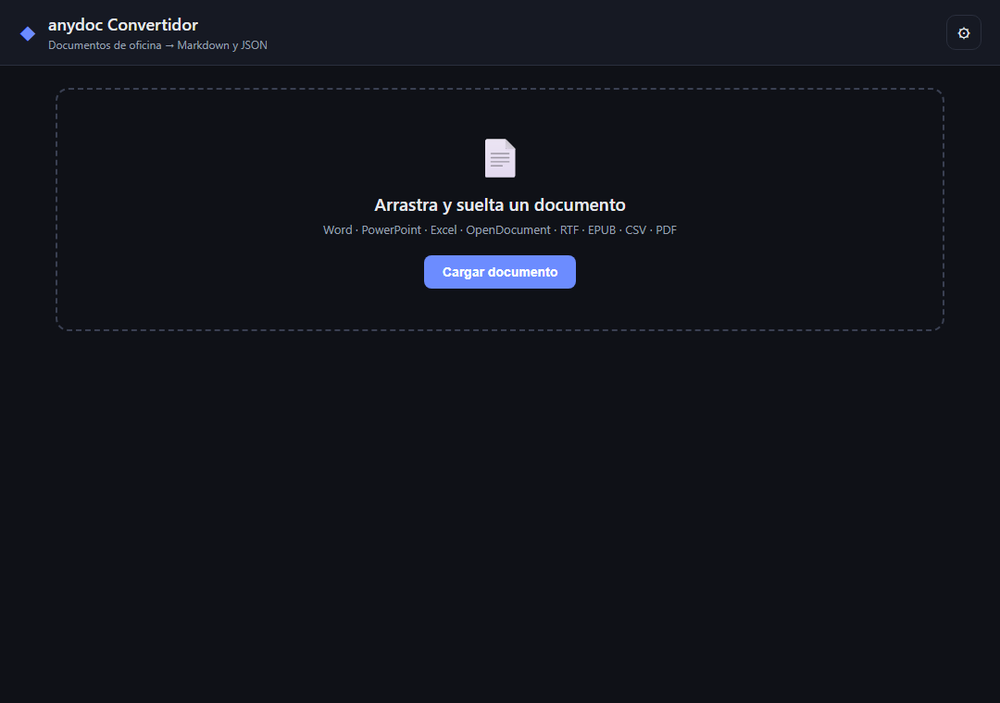

# Guía de uso para el equipo

**anydoc Convertidor** convierte documentos de oficina a **Markdown** y **JSON** sin salir de tu PC. Esta guía es para quien solo quiere usarlo.



## 1. Instalar

Elige **una** de las dos formas.

### A. Con el instalador (.exe)
1. Pide el instalador `anydoc-convertidor-setup-<versión>.exe` a quien lo generó, o descárgalo de la sección **Releases** del repositorio si está publicado.
2. Ejecútalo y sigue el asistente.

> Windows puede mostrar «SmartScreen» porque el instalador no está firmado. Elige **Más información → Ejecutar de todas formas** solo si el archivo te llegó de una fuente de confianza.

### B. Desde el código
Necesitas [Node.js](https://nodejs.org) 20 o superior.

```bash
git clone https://github.com/efernandez1986/anydoc-convertidor.git
cd anydoc-convertidor
npm install
npm start
```

## 2. Convertir un documento

1. Arrastra el archivo a la zona punteada, o pulsa **Cargar documento**.
2. Espera unos segundos. El resultado aparece en dos pestañas:
   - **Markdown**: vista previa y código.
   - **JSON**: nombre, formato, tamaño, el Markdown y el modelo estructurado (bloques, tablas, notas al pie, archivos incrustados en base64).
3. Usa **Copiar**, **Descargar .md** o **Descargar .json**.
4. **Cambiar** carga otro documento.

### Formatos admitidos

| Tipo | Extensiones |
|---|---|
| Word | `.doc` `.docx` `.docm` |
| PowerPoint | `.ppt` `.pps` `.pot` `.pptx` `.pptm` `.ppsx` `.ppsm` |
| Excel | `.xls` `.xlsx` `.xlsm` `.xlsb` |
| OpenDocument | `.odt` `.ods` `.odp` |
| Otros | `.rtf` `.epub` `.csv` `.pdf` |

## 3. PDFs escaneados (OCR opcional)

Un PDF con texto seleccionable se convierte sin más. Un PDF que es solo imagen necesita OCR:

1. Pulsa ⚙ **Ajustes**.
2. Activa **OCR en la nube**.
3. Pega tu **API key de Firecrawl** (`fc-...`) y pulsa **Guardar ajustes**.

Cada persona usa **su propia** API key. No compartas una key por chat ni la subas al repositorio.

## 4. Privacidad: qué sale de tu equipo

| Situación | ¿Se envía algo a internet? |
|---|---|
| Cualquier formato, OCR desactivado | **No.** Todo ocurre en tu PC |
| PDF escaneado con OCR activado | **Sí.** Ese PDF se envía a Firecrawl Parse |

Para documentos confidenciales o con datos personales, **deja el OCR desactivado**, o confirma antes que la política de tu equipo permite enviarlos a un servicio externo.

La API key se guarda en un archivo local de ajustes (`settings.json`) dentro de la carpeta de datos de la app en `%APPDATA%`, **sin cifrar**. En un equipo compartido, bórrala de Ajustes al terminar.

## 5. Problemas frecuentes

| Mensaje | Qué hacer |
|---|---|
| «Formato no soportado o no identificable» | Revisa que sea uno de los formatos de la tabla; prueba a guardarlo de nuevo desde su programa |
| «El PDF contiene páginas escaneadas…» | Activa el OCR en la nube (sección 3) o usa un PDF con texto |
| «El archivo está encriptado o protegido con contraseña» | Quita la contraseña y vuelve a intentarlo |
| «El archivo está dañado…» | Ábrelo en su programa original y guárdalo como copia |
| «supera los límites de seguridad» | El archivo tiene demasiada compresión o anidamiento; divídelo |
| «El OCR en la nube no pudo convertir…» | Revisa la API key y tu conexión a internet |
| El JSON del PDF trae `document: null` | Es normal: los PDF solo exponen Markdown, no el modelo estructurado |
| Los `.xls`/`.doc` antiguos salen con menos formato | Son formatos binarios antiguos; si puedes, guárdalos como `.xlsx`/`.docx` |

## 6. Para quien mantiene el proyecto

- **Instalador:** `npm run dist` genera `dist/anydoc-convertidor-setup-<versión>.exe` (solo Windows x64).
- **Versión sin instalador:** `npm run dist:dir`.
- **Compartirlo:** sube el `.exe` a **Releases** de GitHub en lugar de al repositorio (`.gitignore` ya excluye `*.exe` y `dist/`).
- **Dependencias:** `package.json` usa `latest` para `@firecrawl/anydoc`, `electron` y `electron-builder`; `package-lock.json` es lo que fija las versiones. Para actualizar, `npm update` y probar con un par de documentos antes de publicar.
